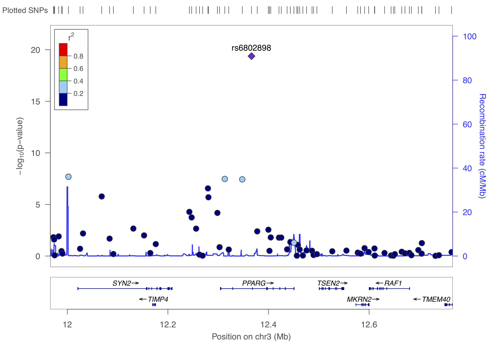
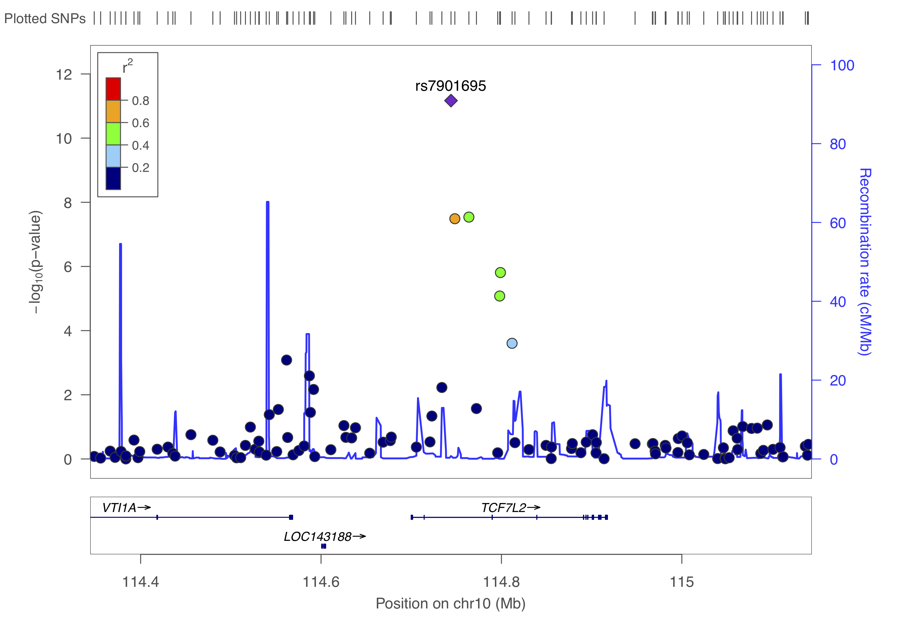
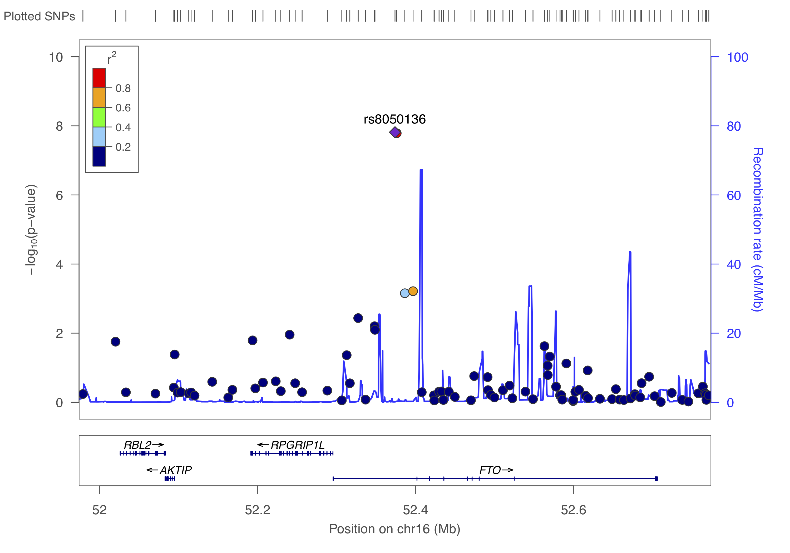

# Regional association plots {#sec-regional-plot}

{.chapter-banner fig-alt="Statistical finemapping"}
<!-- {width=100%} -->
```{r, message = FALSE, warning = FALSE, echo = FALSE, eval = TRUE, include = FALSE}
#| label: load-functions-packages
source("scripts/functions.R")
source("scripts/colors.R")
source("scripts/packages.R")
```

```{r, include = FALSE}
if(!knitr:::is_html_output())
{
  options("width"=56)
  knitr::opts_chunk$set(tidy.opts=list(width.cutoff=56, indent = 2), tidy = TRUE)
  knitr::opts_chunk$set(fig.pos = 'H')
}
```

```{r, message = FALSE, warning = FALSE, echo = FALSE, eval = TRUE, include = FALSE}
#| label: getting_started
# general setting to apply to all chunks - can be overrode per chunk.
opts_chunk$set(echo = FALSE, 
               warning = FALSE, 
               message = FALSE, 
               out.width = "85%", 
               fig.align = "center", 
               tidy = FALSE)
```
First we need to find the independent hits by _clumping_ the results. We will just use the defaults, but please take a note of all the options here [https://www.cog-genomics.org/plink/1.9/postproc#clump](https://www.cog-genomics.org/plink/1.9/postproc#clump){target="_blank"}

```{.bash filename="Terminal"}
plink --bfile ~/data/shared/gwas/gwa --clump dummy_project/data.assoc.logistic --clump-p1 5e-8 --clump-p2 0.05 --clump-kb 500 --clump-r2 0.05 --clump-verbose --out dummy_project/data.assoc.logistic
```
Now you will have a list of all the _independent_ SNPs, _i.e._ the genetic loci, that are associated to the trait.

```{.bash filename="Terminal"}
cat dummy_project/data.assoc.logistic.clumped
```

```{bash, eval = TRUE, echo = FALSE}
#| label: CLUMPS
cat data/dummy_project/data.assoc.logistic.clumped
```

> Question: How many independent hits did you find?

In summary, clumping identifies three loci and now that you know them you can create regional association plots.

## LocusZoom
Now you are ready to visualize regions of interest using a package like [LocusZoom](http://locuszoom.org). Locuszoom is a great and easy tool, you'll soon discover. It's the fast and lazy way to get regional association plots.

First, let's get what we need (`SNP` and `P`) and gzip the results.

```{.bash filename="Terminal"}
printf "SNP\tP\n" > dummy_project/data.assoc.logistic.locuszoom
cat dummy_project/data.assoc.logistic | awk 'BEGIN { OFS = "\t" } $5=="ADD" { print $2, $9 }' >> dummy_project/data.assoc.logistic.locuszoom
gzip -f -v dummy_project/data.assoc.logistic.locuszoom
```

You can to upload this `data.assoc.logistic.locuszoom.gz` Try to visualize each locus using the information above and by following the instructions. Choose HapMap 2, hg18, CEU as the LD-reference.

You should get something like below.

{width=50%}

{width=50%}

{width=50%}

## RACER

An alternative to create regional association plots for each of these loci is using [**RACER**](https://github.com/oliviasabik/RACER){target="_blank"}. This packages offers substantial flexibility, and quite frankly, code-wise is easier to edit - think colorscheme, background etc.  - as it is based on [`ggplot2`](https://ggplot2.tidyverse.org){target="_blank"}. The creator, Olivia Sabik, also wrote a nice [vignette](https://oliviasabik.github.io/RACERweb/index.html){target="_blank"} with excellent instructions.

Using **RACER** is also a step-up to **colocalization** about which you read a bit more in @sec-post-gwas.

Right, so from the above we identified three independent hits: rs6802898, rs7901695, rs8050136. Let's put them in a dataset with their chromosome and basepair position and create a list.

```{r}
#| label: create-variant-list
#| filename: "R"
rsID <- c("rs6802898", "rs7901695", "rs8050136")
CHR <- as.integer(c(3, 10, 16))
BP <- as.integer(c(12366207, 114744078, 52373776))
# BPend <- c(12366207 + 500000, 114744078 + 500000, 52373776 + 500000)

variant_list <- data.frame(rsID, CHR, BP)
```


```{r}
#| label: show-variant-list
#| filename: "R"
variant_list
```


```{r}
#| label: show-variants-of-interest
#| filename: "R"
variants_of_interest <- c(variant_list$rsID)

variants_of_interest
```

We can now take the filtered and prepared GWAS summary statistics, _i.e._ `gwas_assoc_compl` you created earlier in @sec-gwas-visuals-cocalc, to draw three nice regional association plots around these variants. 

This file should contain the following:

```{.default filename="Output"}
tibble [306,102 × 14] (S3: tbl_df/tbl/data.frame)
 $ SNP     : chr [1:306102] "rs10000010" "rs10000023" "rs10000030" "rs1000007" ...
 $ CHR     : int [1:306102] 4 4 4 2 4 4 16 4 2 4 ...
 $ BP      : int [1:306102] 21227772 95952929 103593179 237416793 21504615 157793485 24325037 33810744 235355721 77575270 ...
 $ A1      : chr [1:306102] "C" "T" "A" "C" ...
 $ A2      : chr [1:306102] "T" "G" "G" "T" ...
 $ MAF     : num [1:306102] 0.426 0.484 0.162 0.312 0.343 ...
 $ callrate: num [1:306102] 0.999 0.989 0.998 1 0.991 ...
 $ NMISS   : int [1:306102] 3996 3957 3991 4000 3963 3919 3899 3931 3927 3941 ...
 $ NCHROBS : int [1:306102] 7992 7914 7982 8000 7926 7838 7798 7862 7854 7882 ...
 $ BETA    : num [1:306102] 0.04114 -0.00985 -0.02235 0.01784 -0.07904 ...
 $ SE      : num [1:306102] 0.0457 0.0456 0.0605 0.0489 0.0471 ...
 $ OR      : num [1:306102] 1.042 0.99 0.978 1.018 0.924 ...
 $ STAT    : num [1:306102] 0.901 -0.216 -0.37 0.365 -1.677 ...
 $ P       : num [1:306102] 0.3676 0.829 0.7117 0.7152 0.0935 ...
 - attr(*, ".internal.selfref")=<externalptr> 
 - attr(*, "sorted")= chr "SNP"
```

We could limit ourselves by limiting the region to plot by the clump-size (see above), but generally it's fine to just 'take the top variant ± 500kb'.

To colour the variants by their LD with the lead variant, `RACER` asks the [LDlink](https://ldlink.nih.gov){target="_blank"} web service, which needs your personal LDlink token. If you have not set it up yet, do that first (@sec-ldlink-token); check it with `nchar(Sys.getenv("LDLINK_TOKEN")) > 0`, which should return `TRUE`.

::: {.callout-warning}
While it runs, `RACER` prints the web address it uses for LDlink, and that address contains your LDlink token (`...&token=...`). Do not share this output, for example in a screenshot or a notebook you hand in. If you did, request a new token.
:::

```{r, eval = FALSE}
#| label: plot-racer
#| filename: "R"
library(RACER)

RANGE=500000

for(VARIANT in variants_of_interest){
  cat(paste0("Getting data for ", VARIANT,".\n"))

  tempCHR <- subset(variant_list, rsID == VARIANT)[,2]
  tempSTART <- subset(variant_list, rsID == VARIANT)[,3] - RANGE
  tempEND <- subset(variant_list, rsID == VARIANT)[,3] + RANGE
  tempVARIANTnr <- subset(variant_list, rsID == VARIANT)[,1]

  cat("\nSubset required data.\n")
  temp <- subset(gwas_assoc_compl, 
                 CHR == tempCHR & (BP >= tempSTART & BP <= tempEND))

  cat("\nFormatting association data.\n")
  # make sure you have the right column numbers here!
  temp_f = RACER::formatRACER(assoc_data = temp, chr_col = 2, pos_col = 3, p_col = 14)

  cat("\nGetting LD data.\n")
  # LD with the lead variant comes from LDlink (1000G EUR) and needs your LDlink token (see @sec-ldlink-token)
  temp_f_ld = RACER::ldRACER(assoc_data = temp_f, rs_col = 1, pops = "EUR", lead_snp = VARIANT,
                             token = Sys.getenv("LDLINK_TOKEN"),
                             window = 500000, genome_build = "grch37")
  
  cat(paste0("\nPlotting region surrounding ", VARIANT," on ",tempCHR,":",tempSTART,"-",tempEND,".\n"))
  # source(paste0(PROJECT_loc, "/scripts/functions.R"))
  p1 <- singlePlotRACER(assoc_data = temp_f_ld, 
                               chr = tempCHR, build = "hg19", 
                               plotby = "snp", snp_plot = VARIANT,
                               label_lead = TRUE)
  
  print(p1)
  cat(paste0("Saving image for ", VARIANT,".\n"))
  ggplot2::ggsave(filename = paste0("dummy_project/", tempVARIANTnr, ".",VARIANT,".regional_assoc.png"), plot = p1, width = 9, height = 6, units = "in")
  # ggplot2::ggsave(filename = paste0(COURSE_loc, "/dummy_project/", tempVARIANTnr, ".",VARIANT,".regional_assoc.pdf"), plot = p1)
  # ggplot2::ggsave(filename = paste0(COURSE_loc, "/dummy_project/", tempVARIANTnr, ".",VARIANT,".regional_assoc.eps"), plot = p1)
  
  rm(temp, p1,
     temp_f, temp_f_ld,
     tempCHR, tempSTART, tempEND,
     VARIANT, tempVARIANTnr)
}

```

This should produce the figure similar to these below. 
```{r, fig.align = 'center', fig.show = TRUE, echo = FALSE, eval = TRUE, warning = FALSE, message = FALSE}
#| label: fig-show-racer
#| fig-cap: "Regional association plots."
knitr::include_graphics(rep("img/gwas_dummy/rs6802898.rs6802898.regional_assoc.png"))
knitr::include_graphics(rep("img/gwas_dummy/rs7901695.rs7901695.regional_assoc.png"))
knitr::include_graphics(rep("img/gwas_dummy/rs8050136.rs8050136.regional_assoc.png"))
```

> Please note that we are letting RACER plot the variants on genome build 37 (hg19), but we actually provide hg18-based chromosome and basepair positions. The proper thing to do is to [liftOver](https://genome.sph.umich.edu/wiki/LiftOver){target="_blank"} our coordinates to match those in hg19. Here we didn't, because I just wanted to show you the 'how it's done'. 

## Stop playing around

Alright. It's time to stop playing around and do a quick recap of what you've learned.

1. You learned how to convert datasets.
2. You learned how to execute sample QC and create diagnostic graphics
3. You learned how to do the same for SNP QC
4. You learned how to execute an association study given a dataset, covariates, and different assumptions regarding the genetic model.
5. You learned how to visualize results and played around with different visuals. 

You should be ready for the real stuff. And if not, the next chapter will help you get ready: @sec-wtccc1-intro

