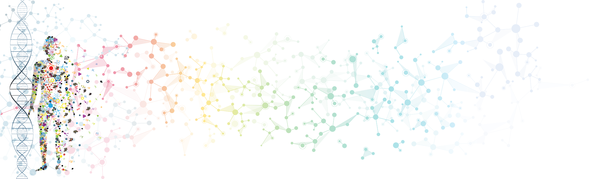

# Phenome-Wide Association Study {#sec-phewas}

{.chapter-banner fig-alt="Phenome-Wide Association Study"}
<!-- {width=70%} -->
```{r, message = FALSE, warning = FALSE, echo = FALSE, eval = TRUE, include = FALSE}
#| label: load-functions-packages
source("scripts/functions.R")
source("scripts/colors.R")
source("scripts/packages.R")
COURSE_loc = "~/Desktop/practical" # getwd()
```

```{r, include = FALSE}
if(!knitr:::is_html_output())
{
  options("width"=56)
  knitr::opts_chunk$set(tidy.opts=list(width.cutoff=56, indent = 2), tidy = TRUE)
  knitr::opts_chunk$set(fig.pos = 'H')
}
```

```{r, message = FALSE, warning = FALSE, echo = FALSE, eval = TRUE, include = FALSE}
#| label: getting_started
# general setting to apply to all chunks - can be overrode per chunk.
opts_chunk$set(echo = TRUE, 
               warning = FALSE, 
               message = FALSE, 
               out.width = "85%", 
               fig.align = "center", 
               tidy = FALSE)
```
Given the large biobanks available nowadays that have also genotyped the participants and collected a vast-array of information on them, it is possible to perform a **Phe**nome-**W**ide **A**ssociation **S**tudy.

There are several options in (@tbl-tab-phewas).

```{r, eval = TRUE, echo = FALSE}
#| label: load-phewas
library("openxlsx")
phewas <- openxlsx::read.xlsx("information.xlsx", sheet = "PheWAS")
```


```{r, tidy = FALSE, eval = TRUE, echo = FALSE}
#| label: tbl-tab-phewas
library("knitr")
knitr::kable(
  phewas, 
  caption = 'PheWAS Resources.',
  # align = ,
  booktabs = FALSE
)
```


> *Assignment*
> 
> 1. Perform a PheWAS with a few of the resources and your favorite SNP from this tutorial. 
> 2. Compare the different websites. What do you notice?
> 3. How is a PheWAS informative?


## What's next?

You now know to what other traits, risk factors and diseases our trait of interest (coronary artery disease) is correlated. An obvious next question would be: is this a causal correlation? We will cover this aspect in the next Chapters with MRBase (@sec-mr-mrbase) and TwoSampleMR (@sec-mr-twosamplemr). To return to the previous Chapter on post-GWAS analyses click [here](@sec-post-gwas).

