# Two Sample Mendelian Randomisation {#sec-mr-twosamplemr}

{.chapter-banner fig-alt="TwoSample Mendelian Randomization"}
<!-- {width=100%} -->
```{r, message = FALSE, warning = FALSE, echo = FALSE, eval = TRUE, include = FALSE}
#| label: load-functions-packages
source("scripts/functions.R")
source("scripts/colors.R")
source("scripts/packages.R")
```

```{r, include = FALSE}
if(!knitr:::is_html_output())
{
  options("width"=56)
  knitr::opts_chunk$set(tidy.opts=list(width.cutoff=56, indent = 2), tidy = TRUE)
  knitr::opts_chunk$set(fig.pos = 'H')
}
```

```{r, message = FALSE, warning = FALSE, echo = FALSE, eval = TRUE, include = FALSE}
#| label: getting_started
# general setting to apply to all chunks - can be overrode per chunk.
opts_chunk$set(echo = TRUE, 
               warning = FALSE, 
               message = FALSE, 
               out.width = "85%", 
               fig.align = "center", 
               tidy = FALSE)
```
We will use the `TwoSampleMR` package to assess the causal effect of type 2 diabetes on coronary artery disease.

Briefly, the workflow of a Two-Sample MR is as follows (see also diagram below):

1. _Select instruments_ for the exposure (perform LD clumping if necessary);
2. _Extract the instruments_ from the MR Base GWAS database for the outcomes of interest;
3. _Harmonise the effect sizes_ for the instruments on the exposures and the outcomes to be each for the same reference allele;
4. _Perform MR analysis_, sensitivity analyses, create plots, compile reports.

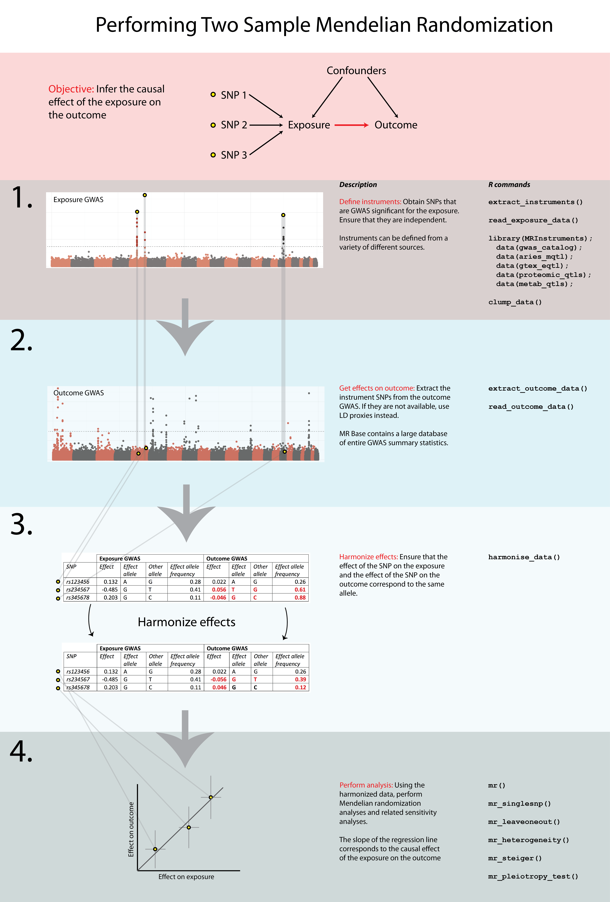

## Checking your OpenGWAS token

`TwoSampleMR` retrieves instruments, outcome data and LD information from the [IEU OpenGWAS database](https://opengwas.io){target="_blank"} through the `ieugwasr` package. Since May 2024 every request must be authenticated with a personal token, and each user has a limited number of queries. You set up your token in @sec-opengwas-token; if you have not done that yet, do it first. Then check that it still works:

```{r, eval = FALSE}
#| label: check-token
#| filename: "R"
nchar(ieugwasr::get_opengwas_jwt()) > 0  # should be TRUE
ieugwasr::user()                         # should show your OpenGWAS user details
```

::: {.callout-tip collapse="true"}
## Troubleshooting
- **`get_opengwas_jwt()` returns an empty string.** `R` did not find your token. Restart `R` first. Still empty? The file is probably not where `R` looks for it: always open it with `usethis::edit_r_environ()`, which opens the right file, and check that the line reads `OPENGWAS_JWT=<token>` without spaces or quotes and that the file ends with an empty line.
- **Error 401 or 403, or a message that the token is missing, invalid or expired.** Generate a new token at <https://api.opengwas.io/profile/>{target="_blank"}, replace it in `.Renviron`, and restart `R`.
- **A message that your allowance or query limit is used up.** Wait until it resets (the message tells you when) and do not re-run the whole chapter; keep the results of each step in an object.
- **Old package versions.** Old versions of `TwoSampleMR` and `ieugwasr` do not support the token: re-install them as shown below.
:::

::: {.callout-warning}
## Rate limits
OpenGWAS limits the number of queries per user. Run the code in this chapter step by step, keep the results in objects, and do not re-run the whole chapter over and over again.
:::

## Installing and loading the packages

Make sure you have up-to-date versions; old versions of `TwoSampleMR` and `ieugwasr` do not support the token. `TwoSampleMR` and `MRInstruments` are installed from the MRC IEU R-universe.

```{r, eval = FALSE}
#| label: install-twosamplemr
#| filename: "R"
install.packages(c("TwoSampleMR", "MRInstruments"),
                 repos = c("https://mrcieu.r-universe.dev", "https://cloud.r-project.org"))
install.packages("ieugwasr")
```

Now load the packages.

```{r, echo = TRUE, eval = FALSE}
#| label: load-twosamplemr
#| filename: "R"
library("TwoSampleMR")
library("MRInstruments")
library("ieugwasr")
```

::: {.callout-tip}
## No token? Use local data
If you cannot use OpenGWAS, the same analysis can be done fully offline: read exposure and outcome summary statistics from files with `read_exposure_data()` and `read_outcome_data()`, and clump locally with `ieugwasr::ld_clump(..., plink_bin = "plink", bfile = "<1000G EUR reference>")` instead of `clump_data()`. See the [`TwoSampleMR` documentation](https://mrcieu.github.io/TwoSampleMR/){target="_blank"}.
:::


## Available outcome

We are ready to load in the available outcomes. 
```{r, eval = FALSE, echo = TRUE}
#| label: listGWAS
#| filename: "R"
ao_twosamplemr <- available_outcomes()
```

```{r, fig.align = 'center', fig.show = TRUE, eval = TRUE, echo = FALSE}
#| label: fig-twosamplemravout
#| fig-cap: "Available data."

```

## Instruments

The `MRInstruments`-package, which comes with `TwoSampleMR`, includes several types of instruments:

- _gwas_catalog_, which includes data from GWAS collected by the GWAS Catalog
- _metab_qtls_, all known quantitative trait loci (meQTLs) associated to circulating metabolites
- _proteomic_qtls_, all known protein QTLs (pQTLs) associated to circulating protein levels
- _gtex_eqtl_, all known expression QTLs (eQTLs) associated to gene expression in 53 different tissues from GTEx Portal
- _aries_mqtl_, all known methylation QTLs (mQTLs) associated to DNA methylation in blood from ARIES


Let's select T2D associated instruments.

```{r, eval = FALSE, echo = TRUE}
#| label: MR_instruments_exposure
#| filename: "R"
data("gwas_catalog")
t2d_gwas <- subset(gwas_catalog, grepl("Mahajan", Author) & PubmedID == "24509480" & Phenotype == "Type 2 diabetes")
t2d_exp_dat <- format_data(t2d_gwas)
```

```{r, fig.align = 'center', fig.show = TRUE, eval = TRUE, echo = FALSE}
#| label: fig-twosamplemrinstruments
#| fig-cap: "Available data."
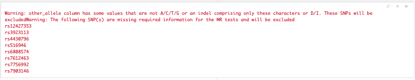
```

## Clumping

Like with identifying independent GWAS hits, it is important for TwoSampleMR to ensure that the instruments for the exposure are independent. We can use MR Base to perform clumping. The European samples from the 1000 genomes project are used to estimate LD between SNPs. You can provide a list of SNP IDs, the SNPs will be extracted from 1000 genomes data, LD calculated between them, and amongst those SNPs that have LD R-square above the specified threshold only the SNP with the lowest P-value will be retained. To do this, use the following command.

```{r, eval = FALSE, echo = TRUE}
#| label: MR_clump
#| filename: "R"
t2d_exp_dat <- clump_data(t2d_exp_dat)
```

```{r, fig.align = 'center', fig.show = TRUE, eval = TRUE, echo = FALSE}
#| label: fig-twosamplemrclump
#| fig-cap: "All available data."
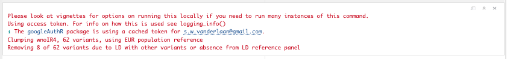
```

## Outcomes

Right, so now we are ready to select the proper outcome, CAD. There are multiple datasets available in MRBase, the database used by `TwoSampleMR`. Let's review them all and select one with the largest overlap with our exposure SNPs.

```{r, eval = FALSE, echo = TRUE}
#| label: MR_outcomes_grep_chd
#| filename: "R"
ao_twosamplemr[grepl("heart disease", ao_twosamplemr$trait), ]
```

```{r, fig.align = 'center', fig.show = TRUE, eval = TRUE, echo = FALSE}
#| label: fig-twosamplemrchd
#| fig-cap: "Available CHD data."
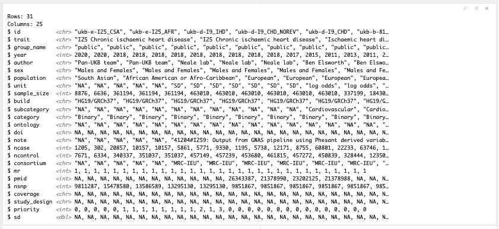
```

It turns out there are several options listed below. 

| Code        | Year        | Author      | Description | Ncases      | Ncontrols |
|-------------|-------------|-------------|-----------|-------------|-------------|
| ukb-d-I9_IHD | 2018 | Neale Labe | Ischaemic heart disease, wide definition | 20857 | 340337 |
| ukb-d-I9_CHD_NOREV | 2018 | Neale Labe | Major coronary heart disease event excluding revascularizations 10157 351037 |
| ieu-a-7 | 2015 | Nikpay _et al._  | Coronary artery disease | 60801 123504 |
| ieu-a-9 | 2013 | Deloukas _et al. _ | Coronary artery disease | 63746 130681 |
| ieu-a-8 | 2011 | Schunkert _et al._ | Coronary artery disease | 22233 | 64762 |

We will use the `ieu-a-7` dataset as this provides the latest and the greatest, but at the same time (when you go into the literature and dig up the publication) you need a good and sharp definition of the outcome you are interested in.


```{r, eval = FALSE, echo = TRUE}
#| label: MR_outcomes
#| filename: "R"
chd_out_dat <- extract_outcome_data(
    snps = t2d_exp_dat$SNP,
    # outcomes = "UKB-a:534" # - this one is deprecated, use the one below
    # Deprecated IDs being used? Detected numeric IDs. Trying to fix, but please note the changes below for future.
    # UKB-a:534  ->  ukb-a-534
    outcomes = "ieu-a-7"
)
```

```{r, fig.align = 'center', fig.show = TRUE, eval = TRUE, echo = FALSE}
#| label: fig-twosamplemrchdout
#| fig-cap: "Extracting available top SNPs."
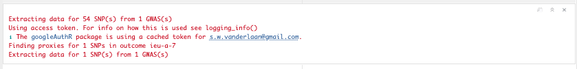
```

### Harmonisation

It is important to make sure that the effect allele associated to T2D of any given SNP is the same as the effect allele associated CAD. In other words, we need to harmonise the data.

```{r, eval = FALSE, echo = TRUE}
#| label: MR_harmonise
#| filename: "R"
dat <- harmonise_data(
    exposure_dat = t2d_exp_dat,
    outcome_dat = chd_out_dat
)
```

```{r, fig.align = 'center', fig.show = TRUE, eval = TRUE, echo = FALSE}
#| label: fig-twosamplemrharmonise
#| fig-cap: "Harmonising the instruments."
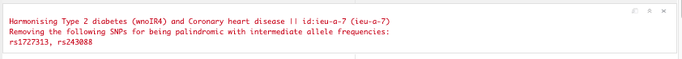
```

<!-- ### Drop duplicate datasets -->
<!-- After data harmonisation, users may find that their dataset contains duplicate exposure-outcome summary sets. This can arise, for example, when a GWAS consortium has released multiple results from separate GWAS analyses for the same trait.  -->
<!-- The best thing to do, is to prune the datasets so that only the exposure-outcome combination with the highested expected power is retained.  -->
<!-- In our case we only have 1 dataset for the exposure and 1 for the outcome. But if you don't, you can use the command below. -->

<!-- ```{r MR_powerprune} -->

<!-- dat <- power_prune(dat,  -->
<!--                    method = 1, -->
<!--                    dist.outcome = "binary") -->

<!-- ``` -->

### Mendelian randomisation

Now that the data is harmonised, we are ready to perform a MR and test for a causal relation of T2D with CAD.
```{r, eval = FALSE, echo = TRUE}
#| label: MR_analysis
#| filename: "R"
res <- mr(dat)

DT::datatable(res, caption = "MR of type 2 diabetes and coronary artery disease", rownames = FALSE)
```

```{r, fig.align = 'center', fig.show = TRUE, eval = TRUE, echo = FALSE}
#| label: fig-twosamplemranalysis
#| fig-cap: "Primary MR analysis."
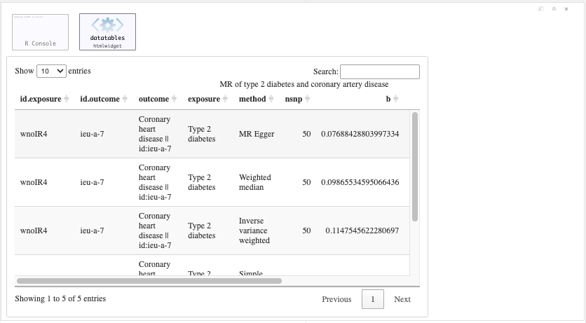
```

> Question: What is the causal effect of T2D on CAD? Can you describe this using the knowledge from the lecture and the results in the table.

Several tests are applied. You can change the method(s) applied by using the `method_list` flag. Below a list of available methods.

```{r, echo = FALSE, eval = TRUE, echo = FALSE, message = FALSE, warning = FALSE}
#| label: MR_methods
knitr::kable(mr_method_list(), caption = "Available MR methods", row.names
 = FALSE)
```

### Heterogeneity & Pleiotropy

Many genetic variants are associated to multiple traits, thus _pleiotropy_ is common and widespread in the human genome. This poses as an issue to tease apart causal relations in Mendelian randomisation.
_Vertical pleiotropy_ arises because a SNP influences one trait, which in turn influences another. We can use MR to estimate the causal influence between the traits.
_Horizontal pleiotropy_ arises due to SNPs influencing two traits through independent pathways[@hemani2018].

Further, we should test for study heterogeneity.

```{r, eval = FALSE, echo = TRUE}
#| label: MR_heterogeneity
#| filename: "R"
mr_heterogeneity(dat)
```

```{r, fig.align = 'center', fig.show = TRUE, eval = TRUE, echo = FALSE}
#| label: fig-twosamplemrheterogeneity
#| fig-cap: "MR heterogeneity."
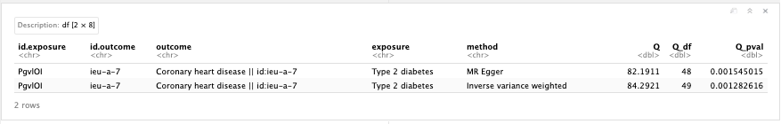
```

```{r, eval = FALSE, echo = TRUE}
#| label: MR_pleiotropy
#| filename: "R"
mr_pleiotropy_test(dat)
```

```{r, fig.align = 'center', fig.show = TRUE, eval = TRUE, echo = FALSE}
#| label: fig-twosamplemrpleiotropy
#| fig-cap: "MR pleiotropy."
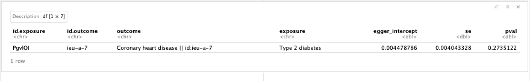
```

> Question: What do the results of the heterogeneity and pleiotropy tests tell you?

### Leave-one-out

It is also key to inspect the causal effects per SNP and perform a leave-one-out analysis.

```{r, eval = FALSE, echo = TRUE}
#| label: MR_SNP_LOO_SINGLE
#| filename: "R"
res_single <- mr_singlesnp(dat)
DT::datatable(res_single, caption = "Single SNP MR analysis", rownames = FALSE)
```

```{r, fig.align = 'center', fig.show = TRUE, eval = TRUE, echo = FALSE}
#| label: fig-twosamplemrsingle
#| fig-cap: "Single SNP analysis results."
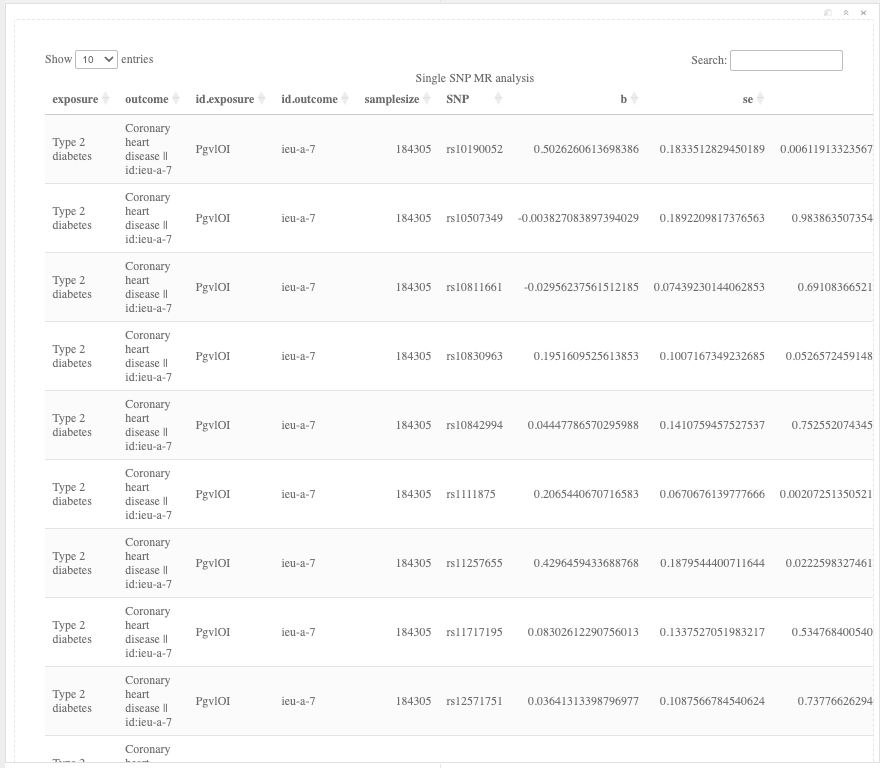
```

```{r, eval = FALSE, echo = TRUE}
#| label: MR_SNP_LOO
#| filename: "R"
res_loo <- mr_leaveoneout(dat)
DT::datatable(res_loo, caption = "Leave-one-out MR analysis", rownames = FALSE)
```

```{r, fig.align = 'center', fig.show = TRUE, eval = TRUE, echo = FALSE}
#| label: fig-twosamplemrloo
#| fig-cap: "Leave-One-Out analysis results."
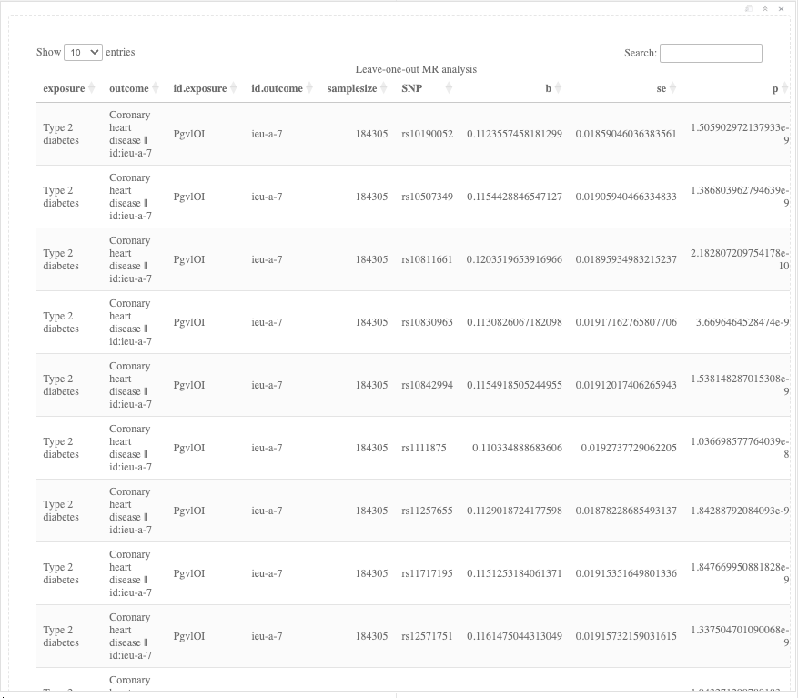
```

> Question: What do the results of the single SNP and leave-one-out analyses tell you?

### Visualisation

It is important to present the causal inference graphically.

**Scatter plot**

```{r, eval = FALSE, echo = TRUE}
#| label: MR_visualisation_Scatter
#| filename: "R"
res <- mr(dat)
p1 <- mr_scatter_plot(res, dat)
p1
```

```{r, fig.align = 'center', fig.show = TRUE, eval = TRUE, echo = FALSE}
#| label: fig-twosamplemrscatter
#| fig-cap: "Scatter plot."
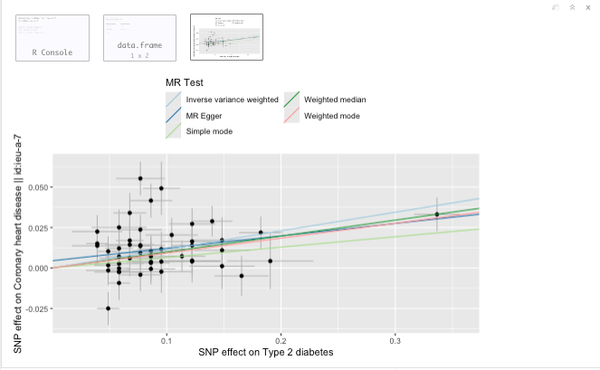
```

> Question: What do you see in the scatter plot? And what can you conclude from this?

**Single SNP plot**

```{r, eval = FALSE, echo = TRUE}
#| label: MR_visualisation_Single
#| filename: "R"
res_single <- mr_singlesnp(dat)
p2 <- mr_forest_plot(res_single)
p2
```

```{r, fig.align = 'center', fig.show = TRUE, eval = TRUE, echo = FALSE}
#| label: fig-twosamplemrforest
#| fig-cap: "Single SNP plot."
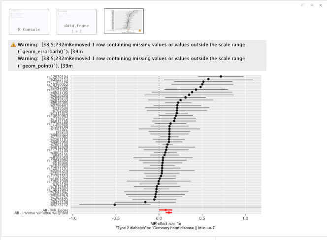
```

> Question: What do you see in the forest plot? And what can you conclude from this?

**Leave-One-Out plot**
```{r, eval = FALSE, echo = TRUE}
#| label: MR_visualisation_LOO
#| filename: "R"
res_loo <- mr_leaveoneout(dat)
p3 <- mr_leaveoneout_plot(res_loo)
p3
```

```{r, fig.align = 'center', fig.show = TRUE, eval = TRUE, echo = FALSE}
#| label: fig-twosamplemrlooplot
#| fig-cap: "Leave-One-Out plot."
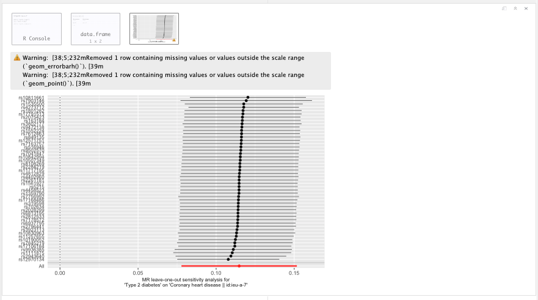
```

> Question: what does a leave-one-out ploy tell you? And what can you conclude from this?

**Funnel plot**
```{r, eval = FALSE, echo = TRUE}
#| label: MR_visualisation_Funnel
#| filename: "R"
res_single <- mr_singlesnp(dat)
p4 <- mr_funnel_plot(res_single)
p4
```

```{r, fig.align = 'center', fig.show = TRUE, eval = TRUE, echo = FALSE}
#| label: fig-twosamplemrfunnelplot
#| fig-cap: "Funnel plot."
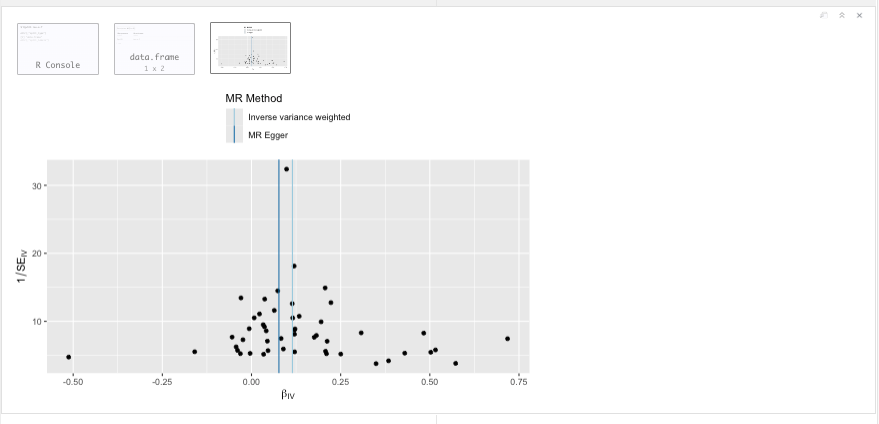
```

> Question: Why would yoy use a funnel plot? And what can it tell you? 

<!-- ### Editing the results -->

<!-- You can edit the results to summarize them in a nice table.  -->

<!-- ```{r MR_editing, echo = TRUE, eval = TRUE} -->
<!-- generate_odds_ratios(res) -->

<!-- res <- mr(dat) -->
<!-- het <- mr_heterogeneity(dat) -->
<!-- plt <- mr_pleiotropy_test(dat) -->
<!-- sin <- mr_singlesnp(dat) -->

<!-- all_res <- combine_all_mrresults(res, het, -->
<!--                                plt, sin, -->
<!--                                ao_slc = TRUE, -->
<!--                                Exp=TRUE, -->
<!--                                split.exposure = FALSE, -->
<!--                                split.outcome = TRUE) -->

<!-- head(all_res[,c("Method","outcome","exposure","nsnp","b","se","pval","intercept","intercept_se","intercept_pval","Q","Q_df","Q_pval","consortium","ncase","ncontrol","pmid","population")]) -->

<!-- DT::datatable(all_res) -->
<!-- ``` -->

> Question: What are your main conclusions from the MR analysis?

## The end?

You are almost at the end. Time to return to the previous chapter on post-GWAS analyses @sec-post-gwas.

